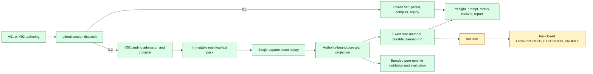
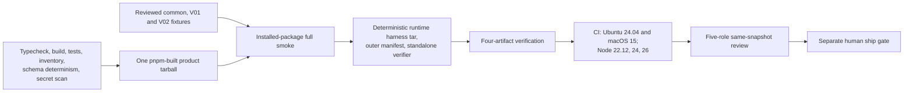

# S35 Contract Closure Architecture

Status: AS-BUILT; final same-snapshot review pending

Verified locally: 2026-08-12 against implementation baseline
`13a8906fdd32b005d29c1eb07ee54f55f80c7fc2` plus the integrated S35 worktree.

## Purpose

S35 adds a literal V02 bounded-loop contract while preserving V01 behavior. It
compiles and replays V02 packs, creates immutable planned runs, evaluates the
pure runtime contract, and deliberately refuses V02 execution until later
enforcement sprints.

## As-built architecture

## Release-evidence path

The fixture corpus exists under `tests/fixtures/compat/s35/`: four common
package oracles, the frozen V01 compatibility corpus, two V02 authoring files,
and exactly nine V02 planned-run members. The installed-package smoke consumes
that corpus and validates public exports, schemas, CLI behavior, V01 replay and
oversize compatibility, V02 validation/planning surfaces, reports, and private
subpath rejection. The four-artifact verifier authenticates the product,
deterministic harness, outer manifest, and workflow-pinned standalone verifier.

## Invariants

1. Unsupported or malformed versions fail before family-specific parsing.
2. V01 parsing, replay, planning, and execution stay isolated and compatible.
3. V02 input and output byte ceilings are enforced, versioned, and charged from
   exact plan-derived cardinalities with checked arithmetic.
4. Compiler and planned-run output uses bounded capture, purpose-bound
   capabilities, create-new writes, and manifest/commit-marker-last durability.
5. Planning consumes exact replay plus explicit policy, role, and repository
   observations; it never fabricates authority.
6. Runtime decisions consume only validated, branded snapshots and a contiguous
   hash-valid ledger prefix.
7. `run start` refuses raw and planned V02 before identity allocation, locks,
   adapters, engines, captured-event reads, or writers.
8. Expected fixtures and the budget oracle do not import production expected-
   side logic.
9. A commit, push, release, S36 start, or visual-architecture phase requires a
   separate operator decision.

## Current verification checkpoint

Local source validation, schema determinism, the 64-file mandatory inventory,
authoritative secret scan, exact V02 fixture verification, installed product
smoke, deterministic runtime-harness construction, four-artifact verification,
and macOS durability tests have passed. The final integrated worktree passed
all 138 test files and 1,477 tests, typecheck, build, and the 136/136 compound
invalid-snapshot precedence matrix. The final product, deterministic harness,
and outer manifest were then rebuilt and verified from the same source state.
The remaining gate is same-snapshot review against one integrated-tree manifest,
not missing implementation work.

The GitHub-hosted 12-cell runtime matrix (2 operating systems x 3 Node.js
versions x 2 npm versions) is configured in `.github/workflows/ci.yml`; local
verification proves its scripts and artifact contract, while an actual hosted
run remains post-commit evidence and is not claimed here.

## Canonical evidence

| Concern | Contract | Implementation evidence |
|---|---|---|
| Schema/versioning | `loopeix-specs/docs/reference/schema-contract.md` | `src/schema/version-dispatch.ts`, generated public schemas |
| Compiler/replay | `loopeix-specs/docs/reference/loop-compiler-contract.md` | `src/compiler/compile-v02.ts`, `src/compiler/replay-v01.ts`, `src/compiler/replay-v02.ts` |
| Planning/writer | S35 sprint contract | `src/run/project-plan-v02.ts`, `src/io/output-capabilities.ts` |
| Runtime/budget | `loopeix-specs/docs/reference/schema-runtime-contract.md` | `src/run/*-v02.ts`, `src/compiler/control-plane-budget-v02.ts` |
| Package/release | `loopeix-specs/docs/reference/package-framework.md` | package-smoke and four-artifact verifier scripts |

The canonical whole-system visual architecture pack is already part of this
integrated S35 snapshot. Its planning-byte changes restart the same-snapshot
review gate, and any later presentation boards must remain non-canonical
mirrors of this verified as-built boundary rather than historical Phase-0 gaps.
